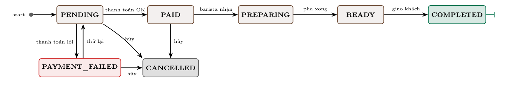

# BrewLite – Đặt cà phê không tiền mặt

Bài tập lớn môn Công nghệ Phần mềm (Trường Đại học Sài Gòn, học kỳ I năm học 2026–2027).

Khách chọn đồ uống (size, topping), thêm vào giỏ, đăng nhập rồi thanh toán qua cổng **MoMo** hoặc **VNPay** (môi trường sandbox của bên thứ ba), nhận biên lai có mã giao dịch của cổng. Sau đó khách nhận mã đơn và theo dõi lịch sử đơn.

## Chức năng

**Khách hàng**
- Xem Menu, xem chi tiết món, chọn size, topping và số lượng trong giới hạn số ly còn bán được.
- Giỏ hàng lưu trên trình duyệt: sửa số lượng, xóa món, nhập mã giảm giá.
- Đăng ký, đăng nhập, thanh toán qua MoMo hoặc VNPay sandbox; thanh toán lại khi thất bại; xem và in biên lai.
- Xem màn hình xác nhận, lịch sử và trạng thái đơn (tự cập nhật khi quầy xử lý); tích điểm thưởng; tự hủy đơn khi quầy chưa nhận.

**Nhân viên (barista)**
- *Quầy*: nhận đơn đã thanh toán, chuyển Đang pha → Chờ giao → Hoàn tất, hủy đơn chưa pha.
- *Kho*: xem tồn nguyên liệu và số ly còn bán được của từng món, nhập thêm kho.
- *Doanh thu*: giao dịch MoMo, VNPay, tiền đã vào, giao dịch cần hoàn tiền.

**Hệ thống**
- Giá luôn do server tính; state machine chặn chuyển trạng thái đơn sai.
- `Idempotency-Key` chống tạo đơn và mở phiên thanh toán trùng; kết quả cổng báo lặp chỉ được xử lý một lần.
- Trừ nguyên liệu theo công thức bằng optimistic locking, nên đặt đồng thời không vượt tồn kho.
- Đơn chưa thanh toán quá 5 phút tự hủy và trả nguyên liệu về kho.

## Công nghệ

| Thành phần | Công nghệ |
| --- | --- |
| Frontend | Next.js 15 (App Router, TypeScript), TailwindCSS 4, Zustand (giỏ hàng, phiên đăng nhập), TanStack React Query |
| Backend | NestJS 11 (TypeScript), REST, class-validator, JWT (Passport), bcrypt |
| CSDL | PostgreSQL 16 + Prisma 6 |
| Thanh toán | MoMo và VNPay, môi trường sandbox (thử nghiệm, không trừ tiền thật) |
| DevOps | Docker Compose, Git |

## Thành viên nhóm

| TV | Họ và tên | MSSV | GitHub | Vai trò Scrum | Phụ trách chính |
| :-: | --- | --- | --- | --- | --- |
| 1 | Phạm Tuyết Nhi | 3124720049 | [phamtuyetnhi756-droid](https://github.com/phamtuyetnhi756-droid) | Scrum Master, Developer | Khung backend, đăng ký/đăng nhập JWT và phân quyền, mã khuyến mãi, Docker |
| 2 | Lê Trương Thảo My | 3124720045 | [M-y-n-e](https://github.com/M-y-n-e) | Product Owner, Developer | Product Backlog, test e2e API công khai và phân quyền, điểm thưởng, trang Quầy, trang 404 |
| 3 | Lý Ngọc Uyên Phương | 3124720055 | [uly2869-collab](https://github.com/uly2869-collab) | Developer | CSDL và dữ liệu mẫu, API sản phẩm, xem và hủy đơn, API Kho, API Quầy |
| 4 | Lê Ngọc Phúc | 3124720053 | [PhucLee23](https://github.com/PhucLee23) | Developer | State machine, tạo đơn và trừ nguyên liệu, thanh toán MoMo/VNPay, test e2e Task 10 |
| 5 | Nguyễn Lê Bảo Yến Vy | 3124720078 | [nlbyv2107-del](https://github.com/nlbyv2107-del) | Developer | Khung Next.js, trang Menu, Chi tiết món, Đăng nhập, trang đơn hàng và biên lai, API Doanh thu |
| 6 | Mai Thu Hường | 3124720031 | [LauraaMao](https://github.com/LauraaMao) | Developer | Giao diện dùng chung, Giỏ hàng, Checkout, chọn cổng thanh toán, trang Kho, trang Doanh thu |

Chi tiết từng hạng mục và Pull Request xem [Product Backlog](docs/scrum/product-backlog.md) và [Danh sách Pull Request](docs/scrum/danh-sach-pr.md).

## Cấu trúc

Số Task ghi theo Product Backlog của đề (Task 1–10).

```
brewlite-assignment1/
├── backend/                            NestJS API, cổng 4000
│   ├── prisma/
│   │   ├── schema.prisma               11 bảng: món, topping, nguyên liệu, công thức, đơn, thanh toán…
│   │   ├── migrations/                 migration tạo CSDL
│   │   └── seed.ts                     dữ liệu mẫu: 15 món, 4 topping, 20 nguyên liệu, mã giảm giá, tài khoản
│   ├── src/
│   │   ├── main.ts, app.setup.ts       khởi động, ValidationPipe, CORS
│   │   ├── app.controller.ts           GET / trả "Hello BrewLite" (Task 1)
│   │   ├── products/                   GET /products, GET /products/:id (Task 2, 4)
│   │   ├── auth/                       đăng ký, đăng nhập bcrypt + JWT, JwtAuthGuard, RolesGuard (Task 7)
│   │   ├── orders/
│   │   │   ├── orders.service.ts       tạo đơn PENDING, xem, hủy, lịch sử GET /orders/me (Task 6, 9, 10)
│   │   │   ├── order-state-machine.ts  sơ đồ chuyển trạng thái đơn (Task 10)
│   │   │   └── pricing.ts              tính giá theo size/topping, mã giảm giá, điểm thưởng (Task 4, 10)
│   │   ├── payments/
│   │   │   ├── payments.service.ts     POST /payments idempotent, xác nhận kết quả, biên lai, doanh thu (Task 8, 10)
│   │   │   ├── payment-session.ts      hạn phiên thanh toán 5 phút
│   │   │   └── gateways/               momo.ts, vnpay.ts: tạo giao dịch và kiểm chữ ký cổng sandbox
│   │   ├── ingredients/                trừ nguyên liệu bằng optimistic locking, API Kho, nhập kho (Task 10)
│   │   ├── promotions/                 GET /promotions/:code kiểm tra mã giảm giá (Task 10)
│   │   ├── common/idempotency.ts       kiểm tra header Idempotency-Key
│   │   └── prisma/                     PrismaService
│   ├── test/
│   │   ├── order-flow.e2e-spec.ts      tiêu chí (a), (b), (c) của Task 10, thanh toán, Quầy, Kho, Doanh thu
│   │   ├── api-public.e2e-spec.ts      API sản phẩm (Task 2), đăng ký/đăng nhập (Task 7), thời gian phản hồi
│   │   └── fake-gateways.ts            cổng MoMo, VNPay giả dùng khi test
│   ├── Dockerfile
│   └── .env.example
├── frontend/                           Next.js, cổng 3000
│   ├── public/images/                  ảnh 15 món
│   ├── src/
│   │   ├── app/
│   │   │   ├── page.tsx                Menu (Task 3)
│   │   │   ├── products/[id]/          Chi tiết món, chọn size và topping (Task 4)
│   │   │   ├── cart/                   Giỏ hàng (Task 5)
│   │   │   ├── login/, register/       Đăng nhập, Đăng ký (Task 7)
│   │   │   ├── checkout/               Thanh toán: mã giảm giá, chọn MoMo hoặc VNPay (Task 8)
│   │   │   ├── payments/[id]/          chờ kết quả từ cổng; receipt/ là trang biên lai (Task 8)
│   │   │   ├── orders/                 Lịch sử đơn; [id]/ là màn hình xác nhận đơn (Task 9)
│   │   │   ├── admin/orders/           Quầy của nhân viên
│   │   │   ├── admin/ingredients/      Kho
│   │   │   ├── admin/revenue/          Doanh thu
│   │   │   └── not-found.tsx, error.tsx  trang 404, trang lỗi
│   │   ├── components/                 Header (badge giỏ hàng), AuthForm, PaymentForm, ui.tsx
│   │   ├── store/                      cart.ts, auth.ts: Zustand lưu giỏ hàng và phiên đăng nhập (Task 5, 7)
│   │   └── lib/                        api.ts gọi API và báo lỗi tiếng Việt, types.ts, format.ts
│   ├── Dockerfile
│   └── .env.example
├── docs/
│   ├── api.md                          hợp đồng API
│   ├── images/                         sơ đồ trạng thái đơn hàng
│   └── scrum/                          Product Backlog, Sprint 1–3, danh sách PR, test case
├── .github/pull_request_template.md    mẫu Pull Request
├── .env.example                        khóa VNPay sandbox cho Docker Compose
└── docker-compose.yml                  db + backend + frontend (Task 9)
```

## Chạy nhanh bằng Docker (1 lệnh)

Yêu cầu: Docker Desktop và Internet (để thanh toán qua sandbox MoMo, VNPay).

```bash
git clone https://github.com/PhucLee23/brewlite-assignment1.git
cd brewlite-assignment1
cp .env.example .env     # điền khóa VNPay sandbox (xem mục Cổng thanh toán sandbox)
docker compose up -d --build
```

Lần đầu mất vài phút để tải image và build.

| Dịch vụ | Địa chỉ |
| --- | --- |
| Web | http://localhost:3000 |
| API | http://localhost:4000 |
| PostgreSQL | localhost:5432 (user/pass/db: `brewlite`) |

Backend tự chạy migration và nạp dữ liệu mẫu khi khởi động. Seed chạy lại nhiều lần vẫn an toàn: không nhân đôi dữ liệu, không ghi đè tồn kho.

| Việc | Lệnh |
| --- | --- |
| Xem log backend | `docker compose logs -f backend` |
| Tắt, giữ nguyên dữ liệu | `docker compose down` |
| Bật lại | `docker compose up -d` |
| Build lại sau khi sửa code | `docker compose up -d --build` |
| Tắt và xóa luôn dữ liệu | `docker compose down -v` |

## Chạy ở chế độ phát triển

Yêu cầu: Node.js 22 trở lên và Docker (để chạy PostgreSQL).

```bash
# 1. CSDL
docker compose up -d db

# 2. Backend – http://localhost:4000
cd backend
cp .env.example .env
npm install
npx prisma migrate dev      # tạo bảng
npm run seed                # dữ liệu mẫu
npm run start:dev

# 3. Frontend – http://localhost:3000 (terminal khác)
cd frontend
cp .env.example .env.local
npm install
npm run dev
```

> Với npm 11, nếu thấy cảnh báo "install scripts not yet covered by allowScripts", các gói Prisma đã được cho phép sẵn trong `backend/package.json`, nên không cần làm gì thêm.

## Biến môi trường

Mẫu nằm trong [.env.example](.env.example) (Docker Compose), [backend/.env.example](backend/.env.example) và [frontend/.env.example](frontend/.env.example).

| Biến | Nơi dùng | Ý nghĩa |
| --- | --- | --- |
| `DATABASE_URL` | backend | Chuỗi kết nối PostgreSQL |
| `PORT` | backend | Cổng API, mặc định 4000 |
| `JWT_SECRET`, `JWT_EXPIRES_IN` | backend | Khóa ký JWT và thời hạn token |
| `FRONTEND_URL` | backend | Địa chỉ frontend được phép gọi API (CORS), nhiều địa chỉ cách nhau bằng dấu phẩy |
| `VNPAY_TMN_CODE`, `VNPAY_HASH_SECRET` | backend | Mã website và chuỗi bí mật VNPay sandbox |
| `MOMO_PARTNER_CODE`, `MOMO_ACCESS_KEY`, `MOMO_SECRET_KEY` | backend | Khóa MoMo test; để trống thì dùng khóa test công khai |
| `PUBLIC_API_URL` | backend | Địa chỉ công khai của API để cổng gọi IPN |
| `NEXT_PUBLIC_API_URL` | frontend | Địa chỉ backend; được nhúng lúc build, đổi thì phải build lại frontend |

## Cổng thanh toán sandbox

BrewLite không tự quyết đơn đã được trả tiền: khách trả trên trang của **MoMo** hoặc **VNPay** (môi trường thử nghiệm của bên thứ ba), và đơn chỉ sang `PAID` khi cổng xác nhận bằng kết quả có chữ ký.

**VNPay** (mỗi người hoặc cả nhóm dùng chung một tài khoản):
1. Đăng ký merchant test ở https://sandbox.vnpayment.vn/devreg/ (ô *Địa chỉ URL* điền tên miền chưa ai đăng ký, ví dụ `https://<tài-khoản-github>.github.io`).
2. VNPay gửi email gồm mã website (`vnp_TmnCode`), chuỗi bí mật (`vnp_HashSecret`), tài khoản trang quản trị merchant (https://sandbox.vnpayment.vn/merchantv2/) và thẻ test.
3. Điền vào `.env` ở thư mục gốc (Docker) và `backend/.env` (chạy dev):

```env
VNPAY_TMN_CODE=<mã website>
VNPAY_HASH_SECRET=<chuỗi bí mật>
```

Hai file này nằm trong `.gitignore`. **Không commit chuỗi bí mật**: ai có nó thì ký được kết quả "đã thanh toán" giả nhân danh BrewLite.

**MoMo**: không cần đăng ký. Để trống các biến `MOMO_*` thì backend dùng bộ khóa test MoMo công bố công khai trong code mẫu chính thức (https://github.com/momo-wallet/payment).

**Thẻ thử nghiệm** (hiện cả trong mục *Thông tin thẻ thử nghiệm* ở trang Thanh toán):

| Cổng | Cách trả |
| --- | --- |
| VNPay | *Thẻ nội địa và tài khoản ngân hàng* → **NCB**, số thẻ `9704198526191432198`, tên `NGUYEN VAN A`, ngày phát hành `07/15`, OTP `123456` |
| MoMo | *Thanh toán bằng thẻ ATM*, số thẻ `9704000000000018`, ngày phát hành `03/07`, tên `NGUYEN VAN A`, số điện thoại bất kỳ, OTP `OTP`. Hoặc cài app MoMo bản test để quét mã |

**Xác nhận kết quả khi chạy trên máy cá nhân:** MoMo, VNPay báo kết quả qua IPN (server gọi server), nhưng IPN đi từ Internet nên không tới được `localhost`. Vì vậy:
- Khi cổng chuyển khách về BrewLite, backend kiểm tra chữ ký trên link rồi **gọi API tra cứu giao dịch** của cổng.
- Trang chờ cũng tự tra cứu, nên khách trả bằng app trên điện thoại thì máy tính vẫn cập nhật.
- Endpoint IPN có sẵn (`/payments/momo/ipn`, `/payments/vnpay/ipn`) cho lúc API có địa chỉ công khai.

## Dữ liệu mẫu

| Loại | Giá trị |
| --- | --- |
| Tài khoản khách | `khach@brewlite.vn` / `123456` |
| Tài khoản barista (STAFF) | `barista@brewlite.vn` / `123456` (có thêm trang *Quầy*, *Kho* và *Doanh thu*) |
| Mã giảm giá | `BREW10` (−10%, đơn từ 50.000đ), `WELCOME20` (−20%, đơn từ 100.000đ), `HETHAN` (đã hết hạn, dùng để demo lỗi) |
| Món ít hàng | Cold brew chỉ đủ nguyên liệu cho 5 ly size S (4 ly size M, 3 ly size L), dùng để demo kiểm soát tồn kho |
| Nguyên liệu | 20 nguyên liệu, công thức cho 15 món và 4 topping trong [seed.ts](backend/prisma/seed.ts) |

## Xem cơ sở dữ liệu

CSDL chạy trong Docker, nên cần chạy `docker compose up -d` trước.

- **Prisma Studio:** chạy `cd backend && npx prisma studio` (lần đầu chép `backend/.env.example` thành `backend/.env` và chạy `npm ci`), rồi mở http://localhost:5555.
- **VS Code, Antigravity, Cursor:** mở thư mục dự án, cài extension **Database Client** (`cweijan.vscode-database-client2`) theo gợi ý của editor, rồi thêm kết nối PostgreSQL một lần:

| Mục | Giá trị |
| --- | --- |
| Server | `localhost` |
| Port | `5432` |
| Database | `brewlite` |
| User / Password | `brewlite` / `brewlite` |

Các bảng: `Product`, `Topping`, `Ingredient`, `ProductIngredient` (công thức món), `ToppingIngredient` (công thức topping), `Promotion`, `User`, `Order`, `OrderItem`, `OrderIngredient` (nguyên liệu đã trừ của đơn), `Payment`. Tên bảng có chữ hoa nên khi viết SQL phải đặt trong ngoặc kép, ví dụ `SELECT * FROM "Product";`.

## Kiểm thử

```bash
cd backend
npm test             # unit test: state machine, tính giá, khuyến mãi
npm run test:e2e     # test tích hợp với PostgreSQL thật (CSDL riêng brewlite_test)
```

`test:e2e` cần PostgreSQL đang chạy (`docker compose up -d db`). Test tự tạo CSDL `brewlite_test` và áp migration, không đụng vào dữ liệu demo.

Kết quả trên nhánh `main`: **unit test 26/26, e2e 62/62 đạt**.

Ba tiêu chí chấm của Task 10 nằm trong [backend/test/order-flow.e2e-spec.ts](backend/test/order-flow.e2e-spec.ts):

| Tiêu chí | Test |
| --- | --- |
| (a) Chặn chuyển trạng thái sai | `(a) Order State Machine…`, cùng với unit test [order-state-machine.spec.ts](backend/src/orders/order-state-machine.spec.ts) |
| (b) 2 lần cùng Idempotency-Key chỉ tạo 1 đơn | `(b) Idempotency-Key…`: gửi tuần tự, gửi 5 request song song, mở phiên thanh toán lặp chỉ có 1 phiên (chỉ gọi MoMo tạo giao dịch 1 lần), cổng báo kết quả lặp (IPN song song, khách quay về cùng lúc) chỉ cộng điểm 1 lần |
| (c) Đặt đồng thời không vượt tồn kho | `(c) Đặt hàng đồng thời…`: 10 request cùng lúc vào món chỉ còn 3 ly → đúng 3 đơn thành công; 10 request vào 2 món dùng chung nguyên liệu chỉ đủ 3 ly → đúng 3 đơn |

Các nhóm test khác:

| Nhóm test | Kiểm tra |
| --- | --- |
| `Thanh toán qua cổng MoMo, VNPay` | Dùng cổng giả trong [fake-gateways.ts](backend/test/fake-gateways.ts) (ký đúng như cổng thật, không gọi Internet). Link VNPay đúng số tiền và hạn 5 phút; MoMo từ chối tạo giao dịch thì 502; kết quả sai chữ ký, của giao dịch khác hoặc bị sửa số tiền bị từ chối; backend tra cứu lại cổng trước khi chuyển `PAID`; IPN VNPay trả đủ mã `97/01/04/00/02`, IPN MoMo sai chữ ký bị 400; hủy trên cổng rồi trả lại bằng cổng khác; cổng báo đã trừ tiền sau khi phiên hết hạn; biên lai chỉ chủ đơn và nhân viên xem được |
| `Trang Doanh thu của nhân viên` | Tiền chỉ được cộng khi cổng xác nhận thành công; lưu cổng, mã giao dịch, ngân hàng; phiên bỏ dở hiện là hết hạn; đơn đã trả tiền bị hủy chuyển sang *Cần hoàn tiền* và không tính vào tiền đã vào; khách gọi API bị 403 |
| `Tồn kho theo nguyên liệu và công thức` | Hai món dùng chung nguyên liệu ảnh hưởng số ly của nhau; size lớn tốn nhiều nguyên liệu hơn; topping hết thì không đặt được; hủy đơn trả đúng lượng đã trừ; đơn vượt nguyên liệu không bị trừ gì; khách gọi `GET /ingredients` bị 403 |
| `Màn hình quầy của nhân viên` | Chỉ đơn đã thanh toán lên quầy, xếp theo thứ tự trả tiền, đi qua từng nhóm khi nhân viên bấm; khách gọi API bị 403 |
| [api-public.e2e-spec.ts](backend/test/api-public.e2e-spec.ts) | API sản phẩm (Task 2), đăng ký/đăng nhập (Task 7), thời gian phản hồi các API chính dưới 500 ms (mục 4.2 của đề) |
| Unit test [gateways.spec.ts](backend/src/payments/gateways/gateways.spec.ts) | Kiểm tra chữ ký với kết quả thật mà sandbox MoMo đã trả về |

## Kịch bản demo end-to-end

1. Mở http://localhost:3000 và xem menu.
2. Chọn **Cappuccino**, size **L**, topping **Kem cheese**, rồi bấm *Thêm vào giỏ*.
3. Thêm một món khác. Trong giỏ hàng, sửa số lượng hoặc xóa món; tổng tiền và badge trên header tự cập nhật.
4. Bấm *Thanh toán*. Vì chưa đăng nhập, hệ thống chuyển sang trang Đăng nhập; dùng tài khoản demo.
5. Nhập mã `BREW10`, chọn **VNPay**, bấm *Thanh toán … qua VNPay*. Trình duyệt sang trang sandbox của VNPay.
6. Chọn *Thẻ nội địa và tài khoản ngân hàng* → NCB, rồi bấm *Hủy thanh toán*. VNPay chuyển về BrewLite, màn hình báo "Thanh toán không thành công": đơn ở `PAYMENT_FAILED`, giỏ hàng vẫn giữ nguyên.
7. Chọn **MoMo**, bấm thanh toán lại. Trên trang MoMo chọn *Thanh toán bằng thẻ ATM*, nhập thẻ test và OTP (xem bảng thẻ thử nghiệm). MoMo chuyển về BrewLite, màn hình chuyển sang *Đặt hàng thành công* (`PAID`, có mã đơn); đơn không bị tạo lại.
8. Bấm *Xem biên lai thanh toán*: biên lai theo màu MoMo có mã giao dịch MoMo, hình thức, thời gian xác nhận và dữ liệu gốc MoMo gửi về; bấm *In / Lưu PDF* để lưu. Mở *Đơn hàng* để xem lịch sử, điểm thưởng hiển thị trên header.
9. Đăng nhập tài khoản barista, mở *Quầy*: đơn vừa thanh toán nằm ở nhóm *Chờ nhận*. Bấm *Nhận đơn*, *Pha xong*, *Đã giao khách*; trang đơn hàng của khách tự cập nhật theo.
10. Mở *Doanh thu*: giao dịch vừa xong có logo MoMo, mã giao dịch của MoMo và link *Biên lai*, được cộng vào *Tiền đã vào*; giao dịch VNPay bị hủy nằm ở mục *Thất bại*, không được tính tiền. Đối chiếu trên trang quản trị merchant sandbox của VNPay hoặc tra cứu MoMo bằng mã giao dịch.
11. Đặt và thanh toán thêm một đơn. Đơn chưa pha nên khách vẫn thấy nút *Hủy đơn*; lần này để barista bấm *Hủy đơn* ở *Quầy*: nguyên liệu về kho, điểm thưởng bị thu hồi, giao dịch chuyển sang *Cần hoàn tiền* trên trang *Doanh thu* và không còn tính vào *Tiền đã vào*.
12. Mở *Kho*: mỗi món hiện số ly còn bán được và nguyên liệu hết trước. Đăng nhập lại khách, đặt vài ly Latte: trên trang *Kho*, Latte giảm và Cappuccino, Americano cũng giảm theo vì dùng chung espresso và sữa tươi. Hủy đơn đó thì số ly trở lại như cũ. Nhập thêm nguyên liệu *hết trước* của một món ở ô *Nhập kho*: số ly còn bán được của món đó tăng ngay.

### Dùng điện thoại

Mặc định mọi địa chỉ là `localhost`, nên chỉ mở được trên chính máy chạy BrewLite. Để dùng điện thoại, cho điện thoại và máy tính chung một mạng. Nếu Wi-Fi chặn các thiết bị kết nối với nhau, bật **Mobile Hotspot** trên máy tính; khi đó máy tính có IP `192.168.137.1`.

**Mở BrewLite ngay trên điện thoại:** địa chỉ API được nhúng vào frontend lúc build, nên phải build lại theo IP:

```powershell
$env:NEXT_PUBLIC_API_URL="http://192.168.137.1:4000"
$env:FRONTEND_URL="http://localhost:3000,http://192.168.137.1:3000"
docker compose up -d --build
```

Điện thoại mở `http://192.168.137.1:3000` (laptop phải có Internet để điện thoại vào được trang MoMo, VNPay). Thanh toán xong, cổng chuyển điện thoại về đúng địa chỉ này. Nếu điện thoại không mở được trang, cho phép các cổng 3000, 4000 trong Windows Firewall.

## Trạng thái đơn hàng

Sơ đồ theo mục 9.1 của đề, cài đặt trong [order-state-machine.ts](backend/src/orders/order-state-machine.ts):



Chỉ hủy được khi đơn ở `PENDING`, `PAYMENT_FAILED` hoặc `PAID` (khách hoặc nhân viên quầy; đơn chưa thanh toán quá 5 phút tự hủy). Từ `PREPARING` trở đi không hủy được (409). `COMPLETED` và `CANCELLED` là trạng thái cuối.

## Nghiệp vụ backend (Task 10)

- **State machine** – [order-state-machine.ts](backend/src/orders/order-state-machine.ts): `assertTransition` chặn mọi chuyển tiếp không có trong sơ đồ. Câu lệnh cập nhật có điều kiện `WHERE status = <trạng thái cũ>`, nên hai request không thể ghi đè trạng thái của nhau.
- **Thanh toán qua cổng bên thứ ba (MoMo, VNPay sandbox)** – [payments.service.ts](backend/src/payments/payments.service.ts), [momo.ts](backend/src/payments/gateways/momo.ts), [vnpay.ts](backend/src/payments/gateways/vnpay.ts):
    - `POST /payments` giữ chỗ `Idempotency-Key` bằng một bản ghi `PROCESSING` có ràng buộc UNIQUE, rồi mới tạo giao dịch ở cổng. Request lặp lại nhận lại đúng phiên cũ, không tạo giao dịch thứ hai ở cổng.
    - Dòng đơn hàng được khóa bằng `SELECT … FOR UPDATE`, nên một đơn chỉ có một phiên thanh toán đang mở.
    - Đơn chỉ sang `PAID` khi cổng xác nhận: kết quả quay về hoặc IPN phải đúng chữ ký (MoMo HMAC-SHA256, VNPay HMAC-SHA512) và đúng số tiền, rồi backend còn tra cứu lại cổng. Khách không có cách nào tự báo "đã thanh toán" cho BrewLite.
    - Kết quả báo lặp chỉ được xử lý một lần. Phiên bỏ dở quá 5 phút hết hạn và không còn chặn việc hủy đơn.
    - Lưu mã giao dịch của cổng, ngân hàng, hình thức và nguyên văn kết quả có chữ ký làm bằng chứng; trang biên lai in hoặc lưu PDF được.
- **Tồn kho theo nguyên liệu khi đặt đồng thời** – [orders.service.ts](backend/src/orders/orders.service.ts), [inventory.ts](backend/src/ingredients/inventory.ts):
    - Mỗi món và topping có công thức nguyên liệu; size M, L dùng nhiều hơn size S. Số ly còn bán được tính từ nguyên liệu hết trước, nên các món dùng chung nguyên liệu ảnh hưởng lẫn nhau.
    - Tạo đơn trong một transaction: cộng dồn nguyên liệu của cả đơn rồi trừ từng nguyên liệu bằng optimistic locking (`UPDATE … WHERE version = v`).
    - Nếu version đã đổi thì đọc lại và thử lại; nếu không đủ nguyên liệu thì trả 409 và không trừ gì.
    - Nguyên liệu luôn được khóa theo `id` tăng dần, nên hai đơn dùng chung nguyên liệu đặt cùng lúc không bị deadlock.
    - Lượng đã trừ lưu theo đơn; hủy đơn hoặc đơn chưa thanh toán quá 5 phút tự hủy thì trả lại đúng lượng đó.
- **Khuyến mãi và điểm thưởng** – [pricing.ts](backend/src/orders/pricing.ts):
    - Mã giảm giá được kiểm tra hạn dùng và giá trị đơn tối thiểu.
    - Khách được cộng 1 điểm cho mỗi 1.000đ, chỉ khi đơn sang `PAID`; hủy đơn đã `PAID` thì điểm bị thu hồi.
- **Hủy đơn đã thanh toán** – được hủy cho tới khi quầy bấm *Nhận đơn*: khách bấm *Hủy đơn* trên trang đơn hàng, hoặc nhân viên bấm ở trang *Quầy*. Từ lúc đang pha trở đi thì không ai hủy được (409). Giao dịch của đơn đó hiện ở mục *Cần hoàn tiền* trên trang *Doanh thu* để quầy hoàn tiền cho khách.

## API chính

Backend chạy ở cổng 4000. Quyền **Đăng nhập** cần header `Authorization: Bearer <token>`; **Nhân viên** là tài khoản vai trò `STAFF`. Chi tiết request, response và mã lỗi xem [docs/api.md](docs/api.md).

| Phương thức | Đường dẫn | Chức năng | Quyền |
| --- | --- | --- | --- |
| GET | `/` | Kiểm tra API đang chạy (`Hello BrewLite`) | Công khai |
| POST | `/auth/register`, `/auth/login` | Đăng ký, đăng nhập (trả JWT) | Công khai |
| GET | `/auth/me` | Thông tin tài khoản, điểm thưởng | Đăng nhập |
| GET | `/products`, `/products/:id` | Menu; chi tiết món kèm số ly còn bán theo size và topping | Công khai |
| GET | `/promotions/:code?subtotal=` | Kiểm tra mã giảm giá với tạm tính của giỏ | Công khai |
| POST | `/orders` | Tạo đơn `PENDING`, giá do server tính; header `Idempotency-Key` tùy chọn | Đăng nhập |
| GET | `/orders/me`, `/orders/:id` | Lịch sử đơn, chi tiết đơn của mình | Đăng nhập |
| POST | `/orders/:id/cancel` | Khách hủy đơn chưa pha | Đăng nhập |
| GET | `/orders?status=` | Danh sách đơn cho trang Quầy | Nhân viên |
| PATCH | `/orders/:id/status` | Đổi trạng thái đơn ở Quầy | Nhân viên |
| POST | `/payments` | Mở phiên MoMo/VNPay, trả link sang cổng; bắt buộc header `Idempotency-Key` | Đăng nhập |
| GET | `/payments/:id` | Trạng thái phiên (tự tra cứu cổng khi phiên còn mở) | Đăng nhập |
| POST | `/payments/:id/return` | Xác nhận kết quả khi cổng chuyển khách về | Đăng nhập |
| GET | `/payments/:id/receipt` | Biên lai | Chủ đơn hoặc nhân viên |
| POST | `/payments/momo/ipn` | MoMo báo kết quả | Công khai, kiểm chữ ký |
| GET | `/payments/vnpay/ipn` | VNPay báo kết quả | Công khai, kiểm chữ ký |
| GET | `/payments` | Doanh thu, danh sách giao dịch | Nhân viên |
| GET | `/ingredients` | Tồn kho nguyên liệu, số ly còn bán của từng món | Nhân viên |
| POST | `/ingredients/:id/restock` | Nhập thêm kho | Nhân viên |

## Tài liệu Scrum

- [Product Backlog](docs/scrum/product-backlog.md): nhóm Scrum, user story kèm tiêu chí chấp nhận, Definition of Done, kết quả nghiệm thu, backlog cho phiên bản sau.
- [Sprint 1](docs/scrum/sprint-1.md), [Sprint 2](docs/scrum/sprint-2.md), [Sprint 3](docs/scrum/sprint-3.md): Sprint backlog, Daily Scrum, burndown, Review, Retrospective.
- [Danh sách Pull Request](docs/scrum/danh-sach-pr.md), [test case](docs/scrum/test-case.md).

## Lỗi thường gặp

| Lỗi | Cách xử lý |
| --- | --- |
| `Can't reach database server` | Mở Docker Desktop, chạy `docker compose up -d db` (chạy dev) hoặc `docker compose up -d` |
| `port is already allocated` | Tắt chương trình đang dùng cổng 3000, 4000 hoặc 5432 (thường là một bản BrewLite khác đang chạy) rồi chạy lại |
| `@prisma/client did not initialize yet` | Chạy `npx prisma generate` trong thư mục `backend` |
| Thanh toán báo "Chưa cấu hình VNPay" | Điền `VNPAY_TMN_CODE`, `VNPAY_HASH_SECRET` theo mục [Cổng thanh toán sandbox](#cổng-thanh-toán-sandbox), rồi chạy lại `docker compose up -d` |
| Chọn MoMo bị báo lỗi tạo giao dịch (502) | Sandbox MoMo đôi lúc quá tải và không phản hồi; thử lại sau ít phút hoặc chọn VNPay |
| Đổi `NEXT_PUBLIC_API_URL` mà web vẫn gọi địa chỉ cũ | Biến này được nhúng lúc build, chạy `docker compose up -d --build frontend` |
| Điện thoại không mở được trang | Làm theo mục [Dùng điện thoại](#dùng-điện-thoại): build lại theo IP, cho phép cổng 3000, 4000 trong Windows Firewall |
